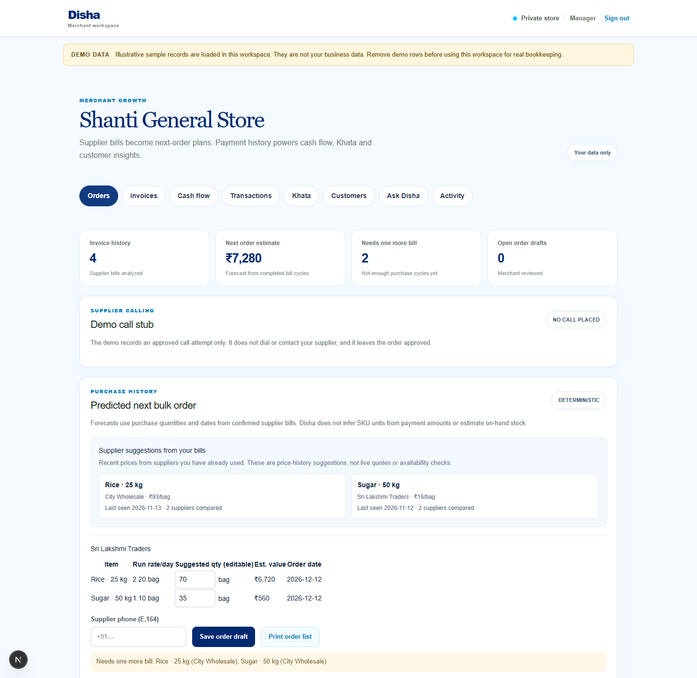
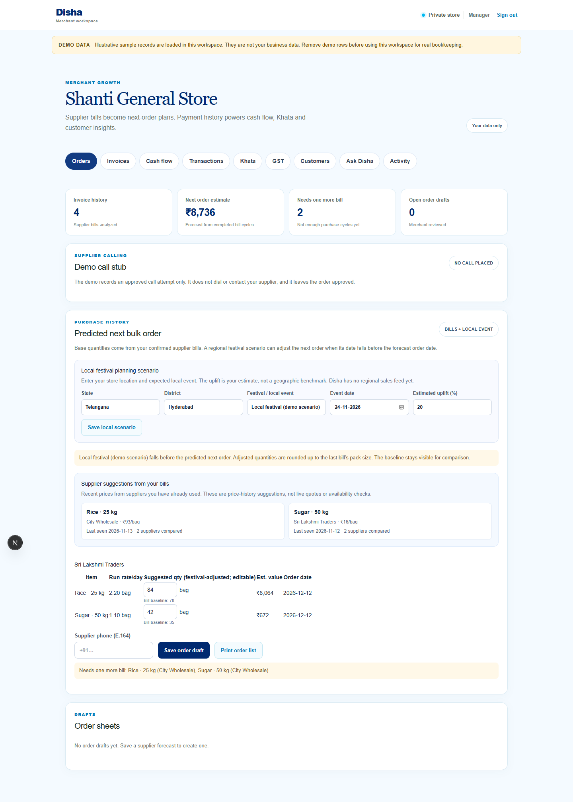
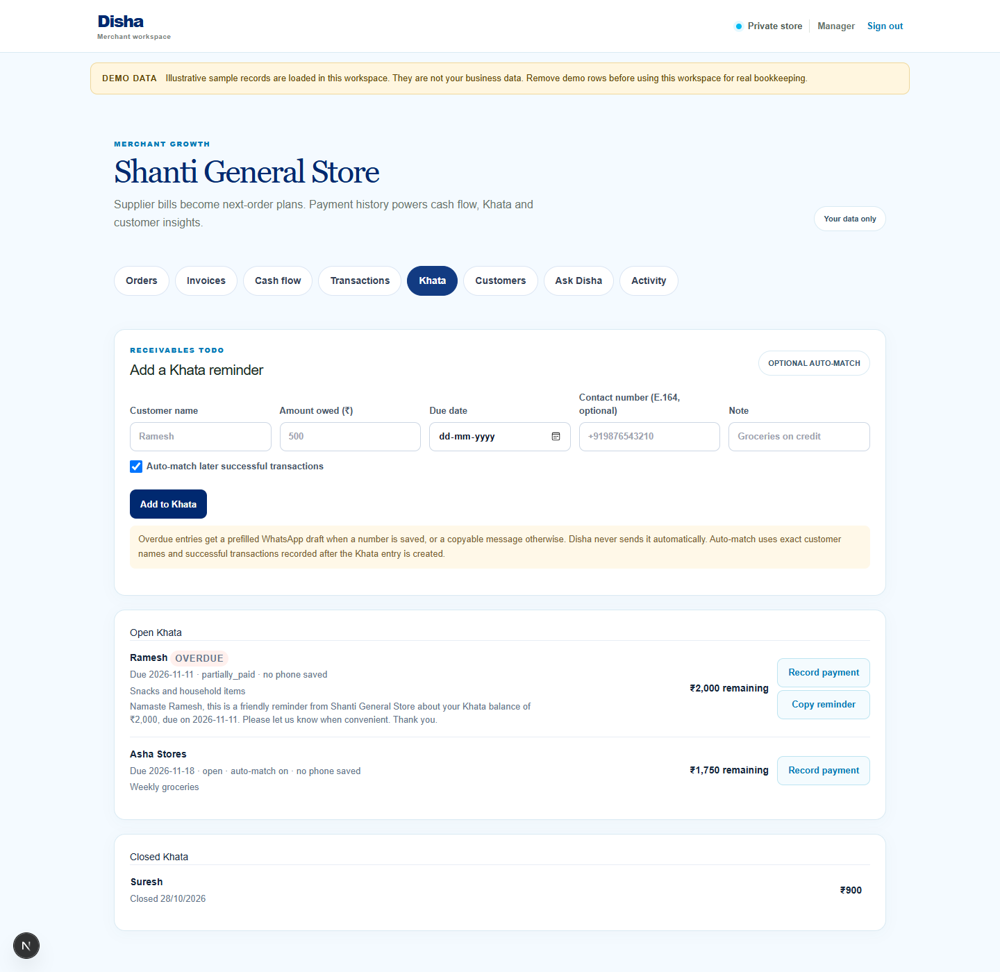
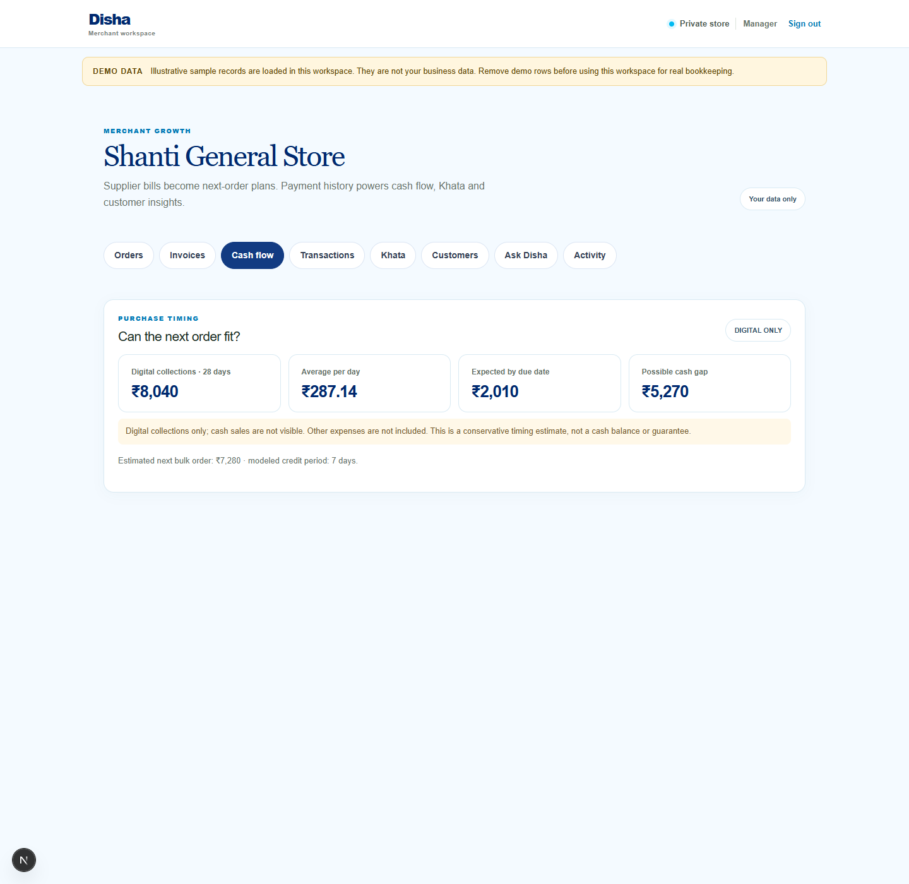
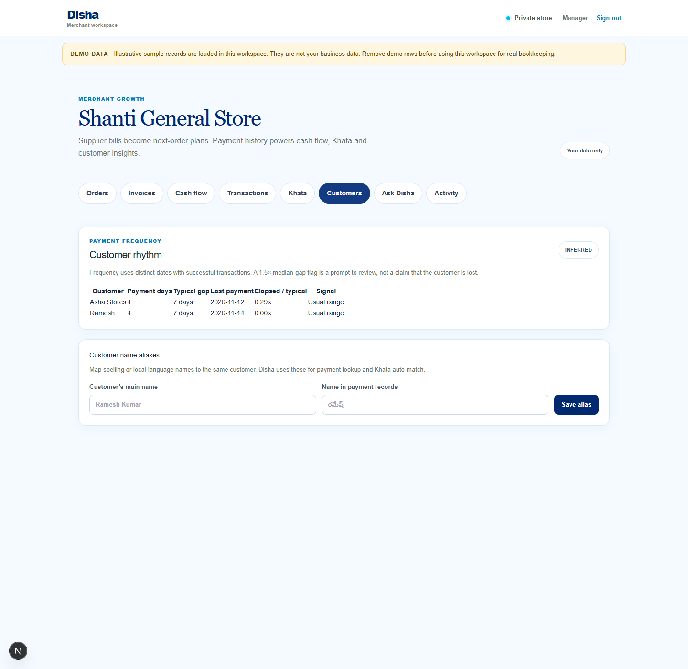

# Disha — merchant growth copilot

## Slide 1 — The shop has records, not time

Small retailers keep supplier bills and receive digital payments, but still have to decide the next order, chase Khata balances and remember upcoming dues by hand.

## Slide 2 — Our USP: the next bulk order from old bills

**Upload supplier bills. Get an editable next-order list.** Disha reads a merchant’s last one to three months of invoices, predicts items and quantities from completed purchase cycles, estimates order timing and lets the merchant review, edit and print.

`Bill photo / PDF / CSV → OCR draft → merchant confirmation → deterministic forecast → editable supplier order`

## Slide 3 — Suggest where to buy, using evidence the merchant already has

For each forecast item, Disha compares the latest matching rates across suppliers in the merchant’s own bill history. It shows the supplier, observed rate, invoice date and number of suppliers compared. This is a useful historical reference, not a live quote.

### Future revenue after usage is proven

- **Merchant subscription:** a monthly plan for repeat order forecasting, cash-flow insights, voice queries and Khata/GST reminders, priced after measuring ongoing merchant value and willingness to pay.
- **Supplier referrals:** optional, disclosed introductions to suppliers. Any referral revenue must never change or conceal the evidence-based recommendation order.
- Keep setup and core record portability simple for small shops; validate pricing with a merchant pilot before claiming revenue.

### Local festival planning

The merchant can add their state, district, local event date and expected uplift. When that event falls before the predicted order, Disha shows an adjusted quantity beside the normal bill-based baseline. Today the uplift is the merchant’s estimate; regional demand learning needs tagged historical bills.

## Slide 4 — Khata becomes a follow-up to-do list

Add who owes what, when it is due and a phone number if available. Disha highlights overdue balances and drafts a polite WhatsApp message for review. The merchant sends it; no message goes out automatically. Partial payments update the balance and paid entries remain in closed history.

## Slide 5 — Cash flow, GST and customer rhythm

- **Cash flow:** successful digital transaction history stored in Disha today estimates likely collections against an upcoming order’s credit window. Always label it “digital collections only”; cash is not visible.
- **GST due tracker:** the merchant records the amount and due date from their accountant or tax portal; Disha flags the deadline and stores full/partial payment references. Disha does not calculate GST, file or pay.
- **Customer frequency:** payment dates show familiar buyers whose normal payment gap has stretched. Treat this as a prompt to review.

## Slide 6 — Talk to the records

Ask in English or Telugu by typing or voice: “Did Ramesh pay?”, “What should I order next month?”, “How much did I collect digitally?” or “Who has not paid as often?” Sarvam handles speech; OpenRouter with LangGraph selects read-only data tools; deterministic code supplies totals and forecasts.

## Slide 7 — Why Paytm fits

Paytm’s Scan Any QR capability helps a customer pay at a shop using a valid UPI QR even when it was issued by another UPI app. This can make a merchant’s checkout familiar and interoperable. It is a Paytm ecosystem advantage; it does not mean Disha reads Paytm data today. [Paytm: Scan any UPI QR code](https://paytm.com/faqs/upi/how-to-scan-a-upi-qr-code-in-paytm)

**Careful claim:** do not say Paytm is the only UPI QR scanner. Paytm confirms QR interoperability; the feature is not exclusive.

## Slide 8 — Trust and product boundaries

- Every forecast number is deterministic and reviewable.
- No SKU sales or on-hand stock is inferred from payment amounts.
- Nothing is ordered or messaged without merchant action.
- Supplier calling remains a local demo stub until LiveKit SIP credentials and an authorized real call flow are configured.
- Paytm endpoints are future integrations subject to access and merchant consent.

## Slide 9 — Pilot measures, not promised results

Measure OCR correction rate, error of the next-bill quantity forecast, time to prepare an order, grounded payment-answer accuracy, overdue Khata resolution and repeat weekly use. Use merchant-consented records and compare each forecast with the next confirmed bill.

## Slide 10 — What we will validate

Can Disha turn the supplier bills small retailers already keep into a more timely, less effortful next order—and help them stay on top of collections and obligations without requiring a new ledger?

**Positioning:** standalone merchant product today, Paytm data integration later. Not an official Paytm product.
