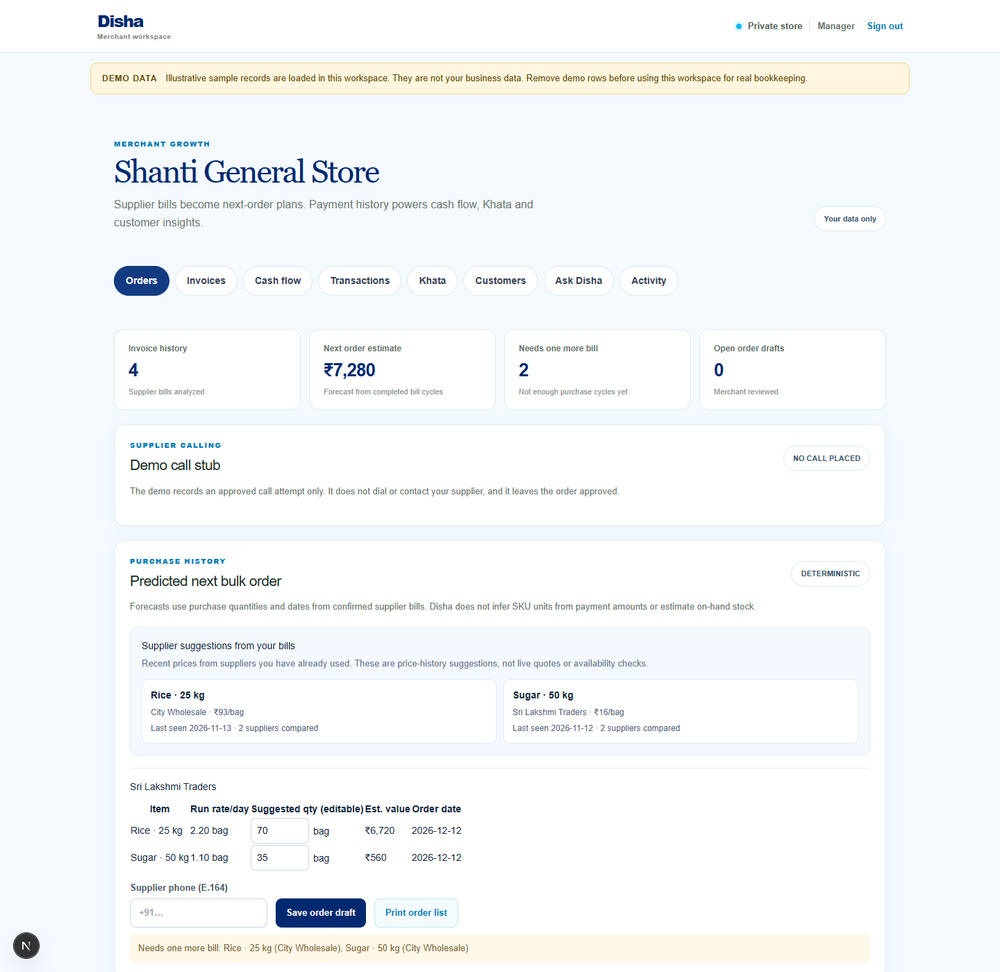
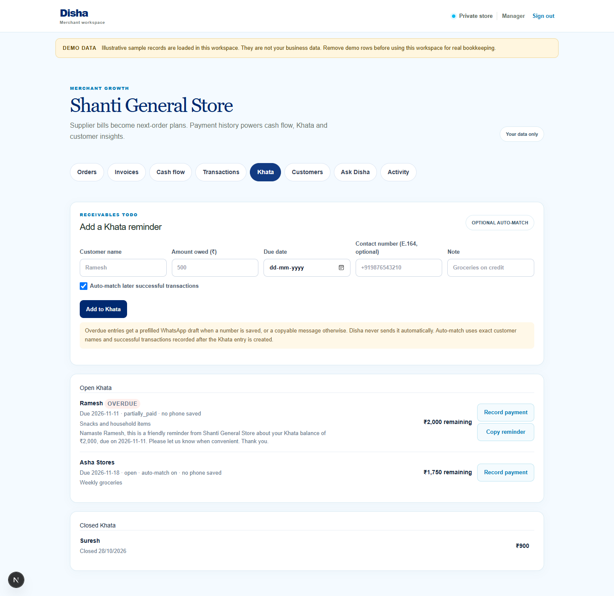
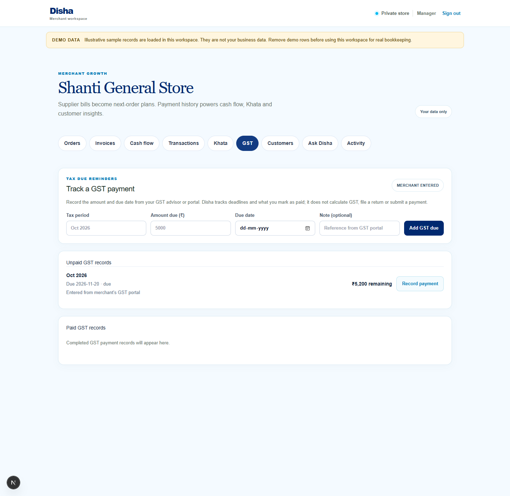
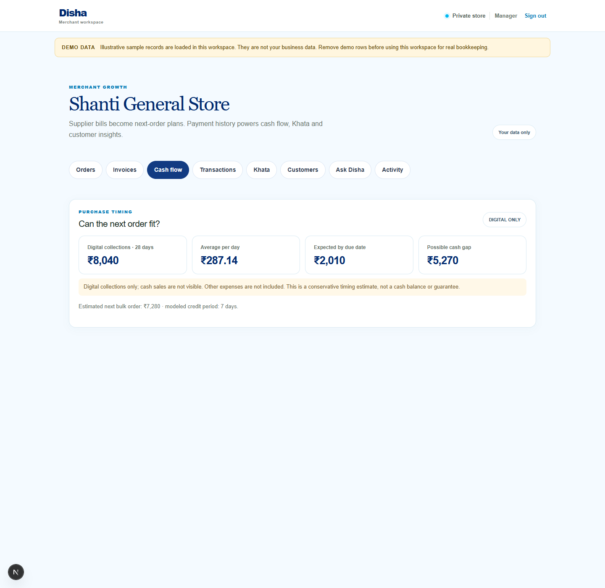
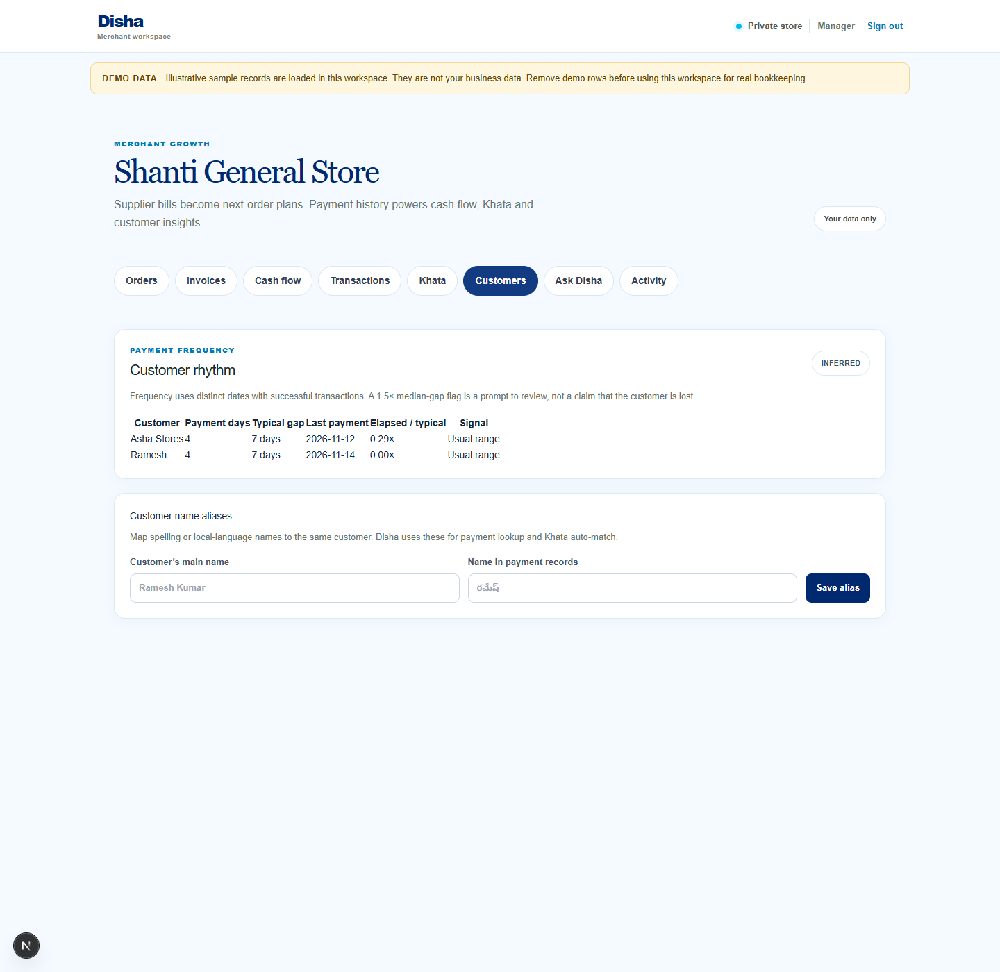

# Disha user journeys

**Audience:** owners and staff of small kirana and neighborhood retail shops
**Product promise:** use the supplier bills and payment records a merchant already has to plan the next order, keep receivables visible, and act before cash deadlines.
**Screenshot note:** all screenshots below come from the local development walkthrough. Names and amounts are illustrative demo records, not a merchant account.

## Product boundaries

- Disha forecasts purchase needs from supplier bill history. It does not infer unit sales from payment amounts or claim to maintain shelf-level stock.
- Disha recommends suppliers only from suppliers already named in merchant-uploaded bills. The recommendation compares the latest observed rate for the same item and unit. It is not a live quote or availability check.
- A supplier order remains a merchant-reviewed draft. The current LiveKit setting is a demo stub and does not call anyone.
- Cash-flow and customer questions use transaction rows stored in Disha today. No Paytm API is connected.
- Khata reminders are drafts the merchant reviews and sends. Disha never auto-messages customers.
- GST amounts and due dates are entered by the merchant from their trusted source. Disha tracks due/paid status; it does not compute GST, file returns or make a payment.
- Paytm has a Scan Any QR feature for valid UPI QRs. This is an ecosystem advantage for collecting from customers at the shop, not a Disha integration or an exclusive UPI capability.

## Journey 1 — From old supplier bills to next month’s bulk order

**Primary user:** shop owner who buys on a supplier cycle and does not keep a formal inventory ledger.
**Job:** “I have old invoices. Tell me what to ask the supplier for next time, and let me check the list.”

### Steps

1. Open **Invoices** and upload several bill photos/PDFs or a CSV covering the last one to three months.
2. Disha extracts supplier, bill number/date, credit days, item, quantity, unit and rate. Each invoice is still only a draft.
3. Check each line and correct OCR mistakes. Arithmetic checks flag quantity × rate and bill-total mismatches. Confirm to save; unconfirmed OCR is not used.
4. Open **Orders**. Disha groups items by supplier and uses completed bill cycles to estimate purchase run rate, next order date, quantity and value.
5. For an item with only one usable bill, Disha asks for one more bill and gives no quantity prediction. It never converts rupees in transaction data into product units.
6. Review **Supplier suggestions from your bills**. For each forecast item, compare the latest observed rate from suppliers that sold that item in the uploaded history. The card gives the supplier, rate, date and comparison count.
7. Edit quantities, add a supplier phone if wanted, then save an order draft. Print the order list or review the call action.
8. Current supplier call mode says **NO CALL PLACED**. The demo stub records no real call and leaves the order approved. Live calling requires configured LiveKit SIP credentials and a real user-authorized call flow.

### What the merchant learns

- Which items are likely due for the next order, estimated quantities and timing.
- Which previously used supplier had the lowest latest recorded price for each item.
- How much the draft may cost and whether uploaded digital collections suggest a possible timing gap.

**Evidence and limits:** the purchase forecast is deterministic. At least two bill cycles are needed per item. Supplier suggestions reflect historical invoice prices only; they do not claim current prices, stock or delivery terms.

## Journey 2 — Suggest a supplier without inventing a marketplace

**Primary user:** owner deciding whether to keep buying from the usual wholesaler or compare another known source.
**Job:** “Who did I buy this from, and which supplier’s latest bill was cheaper?”

### Steps

1. Upload invoices from the merchant’s existing suppliers.
2. Disha normalizes item names and units as written in the confirmed bills.
3. For each forecast line, select the lowest **latest observed** price among suppliers with a matching item and unit.
4. Show the bill date and how many suppliers were actually compared; with only one supplier, label it as one supplier rather than implying a market comparison.
5. Merchant chooses whether to use that supplier, edits the item quantity and saves a draft.

### Guardrails

- No external supplier list, catalog, live availability or live quotation is implied.
- Product matching is based on merchant bill history; differently packed or named products may not be comparable. The merchant reviews the suggestion.
- A future supplier network could offer opt-in discovery or qualified referrals. Recommendations must remain ranked by merchant value and disclose paid placements. Do not sell a higher ranking.

## Journey 3 — Keep Khata as a follow-up to-do list

**Primary user:** owner who gives familiar customers goods on credit and needs a simple list of what is outstanding.
**Job:** “Who owes me, how much is late, and can I send a polite reminder?”

### Steps

1. Open **Khata** and enter customer name, amount, due date, optional E.164 phone number and a short note.
2. Optionally turn on exact-name auto-match. Later successful transaction imports can allocate money to an entry; the merchant can also record a payment manually.
3. Open entries show outstanding balance and status. Past-due open/partial entries carry an **OVERDUE** badge.
4. If a phone number exists, choose **Review WhatsApp reminder**. Disha opens a prefilled WhatsApp draft; the merchant checks the text and presses Send in WhatsApp.
5. If there is no number, choose **Copy reminder**, then send it through the merchant’s chosen channel.
6. When the customer pays, record a partial or full payment. A fully paid entry moves into **Closed Khata** for maintenance/history.

**No-contact rule:** Disha does not send a reminder automatically. No phone number is fabricated in demo records.

## Journey 4 — Track GST due dates and record payments

**Primary user:** owner who has already obtained the payable amount and deadline from their accountant or tax portal.
**Job:** “Help me remember what is due and keep a record after I pay.”

### Steps

1. Open **GST**. Enter the tax period, amount due, due date and optional note from the merchant’s own GST source.
2. Disha lists unpaid periods, remaining balance, and marks a past due date **OVERDUE**.
3. After paying outside Disha, choose **Record payment**. Enter the amount paid and optional bank/challan reference.
4. A partial payment updates the remaining balance. A full payment moves the row into paid history.
5. Verify the payment in the bank or official tax portal; Disha is only a tracker.

**Not a tax filing or payments feature:** no GST liability is calculated, no return is filed, and no money is moved. Ask a qualified tax professional or rely on the official portal for the amount and filing requirements.

## Journey 5 — Ask questions about cash flow and customers

**Primary user:** shop owner who has CSV transaction exports but does not want to search row by row.
**Job:** “Did Ramesh pay? What did I collect? Who is paying less often?”

### Steps

1. Import the merchant’s transaction CSV (names, amount, timestamp, payment mode and status).
2. Ask by typing or voice in English or Telugu. Example: “Did Ramesh pay me last week?”
3. Sarvam STT transcribes voice. OpenRouter/LangGraph calls typed, read-only tools for payment search, cash-flow summary, purchase history, next-order forecast, customer frequency and Khata summary.
4. Deterministic functions compute amounts and date facts. The language model explains returned results; it does not invent a transaction or quantity.
5. Sarvam TTS can speak the answer. The app shows which tools were used.

### Secondary insights

- Cash-flow view uses successful digital records in Disha over the previous 28 days and estimates collections through a recorded supplier credit period. It labels the possible gap as **digital collections only**; cash sales and other expenses are not included.
- Customer frequency compares distinct successful payment dates. A stretched gap is a review signal, not proof that a customer stopped buying.
- Paytm payment endpoints are a possible future source after access and merchant consent. They are not connected today.

## Data and action map

| Information/action | Source | Automatic? | Merchant control |
| --- | --- | --- | --- |
| Supplier item, quantity, price | Confirmed merchant bill | OCR is draft only | Review/correct/confirm |
| Next-order quantity/date | Completed purchase cycles | Deterministic estimate | Edit before saving/printing |
| Supplier suggestion | Latest matching merchant bills | Deterministic historical price comparison | Choose supplier; verify current quote |
| Cash-flow estimate | Successful digital transactions in Disha | Deterministic estimate | Import own transaction file |
| Khata reminder | Merchant-entered entry | Draft prepared on request | Merchant sends manually |
| GST payment status | Merchant-entered amount/date and payment record | No payment action | Merchant verifies external payment |
| Supplier call | LiveKit configuration, currently stubbed | No call in demo mode | Explicit approve before future live call |

## Demo data instructions

Optional SQL seed: [`../../web/supabase/queries/seed_empty_workspaces_demo_data.sql`](../../web/supabase/queries/seed_empty_workspaces_demo_data.sql). It targets manager/owner workspaces only when their core history is empty. Rows are marked `DEMO`, include no real contact numbers, do not approve an order, and do not send calls or messages. The UI shows a DEMO DATA banner for the seeded workspace. Do not use the seeded workspace as real bookkeeping until demo rows are removed through a reviewed cleanup.

## Current external dependencies

- Supabase migrations 120–122 are confirmed run by the merchant; migration 122 enables the GST tracker. Migration 123 is needed for auditing the new GST question tool in Ask Disha.
- OpenRouter and Sarvam secrets must be configured server-side for live agent, OCR and speech paths.
- Live supplier calling is not enabled in the local demo; the stub never contacts a supplier.
- No Paytm API is connected. Transaction CSVs are merchant-provided.
